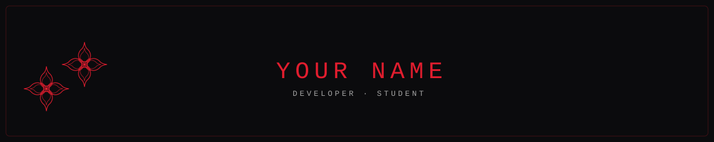

 

<!-- Swap or add badges: https://shields.io and https://simpleicons.org -->

## About me

A young enthusiast in technology and foreign languages, looking always for improvement. 

- Currently: Systems Analysis and Development student
- Interests: Back-end, Cybersecurity, Hardware Engineer, Artificial Intelligence  
- Goal:  Student exchange program in Japan and be a professional developer

## Featured projects

### EasyTask

Application to organize tasks and demands. Target to people who want to have a better organization.

**Tech:** `Python`
**Link:** [View repository](https://github.com/luannlira/EasyTask)

### Saber Digital

Application to teach about fundamental concepts of digital security. Aimed for those who struggle to adapt or doesn't have the knowledge to avoid being scammed or something related.

**Tech:** `Java` `SpringBoot`
**Link:** [View repository](https://github.com/lucashenrique0/LetterDigit-L4Code)

**Still in development**

## Tech stack and tools

| Area | Tools |
|------|-------|
| Languages | Python, Java |
| Interface | Tkinter, HTML/CSS |
| Tools | Git, GitHub, SQLite |

## Stats

 

## Contact

 

